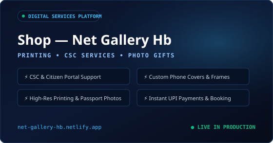
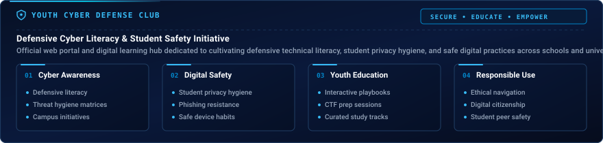

  

   

  

   

  

   
   

  

    
    &nbsp;
    
    &nbsp;
    
    &nbsp;
    
  

 

  
  &nbsp;
  
  &nbsp;
  
  &nbsp;
  
  &nbsp;
  

| Metric | Profile Specification | Details |
| :--- | :--- | :--- |
| **Developer Brand** | `@officialhazim42` | Software Creator & Web/Android Engineer |
| **Academic Base** | CSE Student | Government Polytechnic College Ganderbal, J&amp;K |
| **Engineering Mission** | Useful &amp; Private Tools | Zero-upload client-side processing &amp; accessible utilities |
| **Community Leadership** | Co-Founder | CyberGuard YUVA Youth Cyber Defense Club |

 

 

 

* **In-Browser & Client-Side Utilities:** Developing high-performance web applications that execute entirely within the client runtime using Web APIs, HTML5 Canvas, and WebAssembly, guaranteeing zero server uploads for user files.
* **Document & PDF Engineering:** Building complete document processing pipelines with client-side OCR, page reorganization, compression, and format conversions using `pdf-lib`, `pdf.js`, and `Tesseract.js`.
* **Image Processing & Optimization:** Creating browser tools for modern formats (AVIF, WebP), real-time compression ratio previews, and canvas image manipulation.
* **Progressive Web Applications:** Architecting responsive, installable PWAs with offline resilience, Service Worker caching, and local storage state persistence.

 

 

 

 

 

 

 

<table width="100%">
<tr>
<td width="50%" valign="top">
  
</td>
<td width="50%" valign="top">
  
</td>
</tr>
<tr>
<td width="50%" valign="top">
  
</td>
<td width="50%" valign="top">
  
</td>
</tr>
</table>

 

 

| Domain Category | Core Technologies | Project Evidence &amp; Ecosystem Role |
| :--- | :--- | :--- |
| **Primary Languages** WEB &amp; APP RUNTIME | <code>JavaScript (ES6+)</code> <code>TypeScript</code> <code>Python</code> | Core web application logic, CyberGuard Next.js portal, utility scripts |
| **Academic Base (CSE)** COMPUTER SCIENCE | <code>C</code> <code>C++</code> <code>Java</code> <code>Data Structures &amp; Algorithms</code> | Polytechnic coursework, memory management, algorithms &amp; OOP foundations |
| **Systems &amp; Exploring** CONCURRENCY &amp; SAFETY | <code>PHP</code> <code>Go</code> <code>Rust</code> | Actively exploring modern concurrent systems, microservices &amp; tool safety |
| **Markup &amp; Styling** RESPONSIVE INTERFACES | <code>HTML5</code> <code>CSS3</code> <code>Tailwind CSS</code> | Semantic accessible markup, dark-mode glassmorphism, responsive UI |
| **Frontend Frameworks** APPLICATION ARCHITECTURE | <code>React 19</code> <code>Next.js 16</code> <code>Vite</code> | Component architecture, SSR/Edge rendering, fast bundling workflows |
| **Specialized Compute** CLIENT-SIDE ENGINES | <code>WebAssembly</code> <code>HTML5 Canvas</code> <code>pdf-lib</code> <code>Tesseract.js</code> | In-browser PDF processing, AVIF compression, client-side OCR |
| **Backend &amp; Cloud** EDGE &amp; RELATIONAL DATA | <code>Supabase (PostgreSQL, Auth)</code> <code>Netlify Edge</code> <code>Vercel</code> | Relational schema design, RLS security, global edge hosting |
| **Tooling &amp; CLI** WORKFLOWS &amp; ENVIRONMENT | <code>Git</code> <code>GitHub</code> <code>VS Code</code> <code>Termux Android Environment</code> | Distributed version control, automation scripts &amp; on-device Linux CLI |

 

 

  
  &nbsp;&nbsp;
  
  &nbsp;&nbsp;
  

  A curated portfolio of client-side web applications, in-browser graphics engines, privacy-focused utilities, and cybersecurity platforms engineered by <b>@officialhazim42</b>. Click any card or link to explore live deployments, source code, and architecture specifications.

<!-- ================================================================= -->
<!-- PROJECT 01 — COMPLETE CARD: Shop (Net Gallery Hb)                        -->
<!-- ================================================================= -->

<table width="100%">
<tr>
<td align="center">

</td>
</tr>
<tr>
<td align="left">

  

> **Professional Digital & Local Printing Services Hub:** A dedicated commercial service portal for Net Gallery Hb providing local citizens and students with official digital document processing, CSC governance services, custom photo merchandise, and on-demand professional printing.
>
> 🔹 **Verified Capabilities:**
> • Government & Citizen Services assistance (CSC, Golden Card, PAN, Voter ID, Driving Licence)
> • Professional digital photo printing, custom phone covers, photo framing & passport photos
> • Responsive booking requests, live pricing matrix, instant WhatsApp integration & UPI payments

 

    

  

  

 &nbsp;&nbsp;  &nbsp;&nbsp; 

</td>
</tr>
</table>

 

<!-- ================================================================= -->
<!-- PROJECT 02 — COMPLETE CARD: CyberGuard YUVA                              -->
<!-- ================================================================= -->

<table width="100%">
<tr>
<td align="center">

</td>
</tr>
<tr>
<td align="left">

  

  

    

  

 &nbsp;&nbsp;  &nbsp;&nbsp; 

</td>
</tr>
</table>

 

<!-- ================================================================= -->
<!-- PROJECT 03 — COMPLETE CARD: PDFHub                                       -->
<!-- ================================================================= -->

<table width="100%">
<tr>
<td align="center">

</td>
</tr>
<tr>
<td align="left">

  

> **Privacy-First WebAssembly Architecture:** A comprehensive, privacy-first PDF utility suite engineered to execute 100% within the browser. Files are processed locally on the client device using WebAssembly and client-side JavaScript engines, guaranteeing that sensitive documents never touch external servers.
>
> 🔹 **Verified Capabilities:**
> • 33 specialized tools (merge, split, organize, compress, client-side OCR, repair, conversion)
> • 100% in-browser processing via WebAssembly and Web Workers — zero server uploads
> • Offline PWA capability with persistent client state

 

     

  

  

 &nbsp;&nbsp;  &nbsp;&nbsp; 

</td>
</tr>
</table>

 

<!-- ================================================================= -->
<!-- PROJECT 04 — COMPLETE CARD: ImageHub                                     -->
<!-- ================================================================= -->

<table width="100%">
<tr>
<td align="center">

</td>
</tr>
<tr>
<td align="left">

  

> **Production-Grade Client-Side Image Manipulation:** A production-grade, client-side digital image manipulation platform running locally in the web browser. Empowers users to compress, upscale, isolate subjects, crop, resize, and convert graphics without transmitting a single byte over the network.
>
> 🔹 **Verified Capabilities:**
> • Zero server dependencies with high-throughput HTML5 Canvas rendering
> • Multi-format conversion (JPG, PNG, WebP, AVIF) with instant client-side processing
> • Offline-first PWA with Service Worker caching and zero telemetry tracking

 

     

  

  

 &nbsp;&nbsp;  &nbsp;&nbsp; 

</td>
</tr>
</table>

 

<!-- ================================================================= -->
<!-- PROJECT 05 — COMPLETE CARD: HabitsGrow                                   -->
<!-- ================================================================= -->

<table width="100%">
<tr>
<td align="center">

</td>
</tr>
<tr>
<td align="left">

  

> **Privacy-Centric Routine & Streak Analytics:** A responsive, privacy-centric Progressive Web App designed to help individuals build positive routines, maintain completion consistency streaks, visualize progress analytics, and document mindfulness reflections.
>
> 🔹 **Verified Capabilities:**
> • Daily habit tracking with category grouping, routine checklists & streak trends
> • Offline-first PWA with Service Worker synchronization & Web App Manifest
> • Cloud state persistence backed by Supabase with Row Level Security (RLS)

 

     

  

  

 &nbsp;&nbsp;  &nbsp;&nbsp; 

</td>
</tr>
</table>

 

<!-- ================================================================= -->
<!-- PROJECT 06 — COMPLETE CARD: Advanced Image Compressor                    -->
<!-- ================================================================= -->

<table width="100%">
<tr>
<td align="center">

</td>
</tr>
<tr>
<td align="left">

  

> **High-Efficiency In-Browser Multi-Format Compression:** A focused, responsive web tool engineered for ultra-fast image compression with real-time compression ratios and format detection, packaged in a sleek dark glassmorphic UI.
>
> 🔹 **Verified Capabilities:**
> • Modern AVIF compression engine supporting JPG, PNG, WebP & next-gen AVIF
> • Real-time compression metrics, dynamic before/after previews & file size ratios
> • Automated batch sequential renaming & organized archive exports

 

     

  

  

 &nbsp;&nbsp;  &nbsp;&nbsp; 

</td>
</tr>
</table>

 

<!-- ================================================================= -->
<!-- PROJECT 07 — COMPLETE CARD: Termux Command Guide                         -->
<!-- ================================================================= -->

<table width="100%">
<tr>
<td align="center">

</td>
</tr>
<tr>
<td align="left">

  

> **Native Android Terminal Operations & Hardware APIs:** A structured, practical reference handbook and command guide for mastering native Linux command-line operations and device integration APIs within the Termux Android terminal environment.
>
> 🔹 **Verified Capabilities:**
> • Categorized Linux command index, package configurations & dev setups
> • Practical recipes for interfacing with Android hardware sensors, storage & device APIs
> • On-device development environment setup guides (Git, Node.js, Python)

 

   

  

  

 &nbsp;&nbsp; 

</td>
</tr>
</table>

 

<!-- ================================================================= -->
<!-- PROJECT 08 — COMPLETE CARD: Passport Photo Maker                         -->
<!-- ================================================================= -->

<table width="100%">
<tr>
<td align="center">

</td>
</tr>
<tr>
<td align="left">

  

> **Standard Dimensions & Multi-Photo Print Generator:** A client-side utility built with HTML5 Canvas that enables users to crop, scale, and format photographs to international passport standards and generate multi-photo sheets ready for printing.
>
> 🔹 **Verified Capabilities:**
> • Standard dimension presets supporting international passport standards (2x2 inch, 35x45mm)
> • Automatic multi-photo tiling onto printable standard sheets
> • 100% in-browser HTML5 Canvas processing with instant high-resolution PNG export

 

   

  

  

 &nbsp;&nbsp; 

</td>
</tr>
</table>

 

<!-- ================================================================= -->
<!-- PROJECT 09 — COMPLETE CARD: Text to Audio Converter                      -->
<!-- ================================================================= -->

<table width="100%">
<tr>
<td align="center">

</td>
</tr>
<tr>
<td align="left">

  

> **Native Browser Speech Synthesis & Audio Controls:** A lightweight web tool leveraging the browser-native Web Speech Synthesis API to convert written text into spoken audio with real-time controls for pitch, speech rate, and voice accents.
>
> 🔹 **Verified Capabilities:**
> • Hardware-accelerated speech synthesis using native browser speech engines with zero external APIs
> • Real-time audio adjustment sliders for speech rate, pitch tuning & voice accents
> • Zero dependencies with 100% vanilla client execution and accessible UI

 

   

  

  

 &nbsp;&nbsp; 

</td>
</tr>
</table>

 

<!-- ================================================================= -->
<!-- PROJECT 10 — COMPLETE CARD: Student Task Manager                         -->
<!-- ================================================================= -->

<table width="100%">
<tr>
<td align="center">

</td>
</tr>
<tr>
<td align="left">

  

> **Responsive Task Organization & Persistent Local Storage:** An interactive task organization web application engineered with HTML, CSS, and JavaScript, featuring task creation, completion tracking, filtering, deletion, and local storage state persistence.
>
> 🔹 **Verified Capabilities:**
> • Coursework assignment management with quick-switch filters (All, Active, Completed)
> • LocalStorage state caching ensuring zero progress loss across browser sessions
> • Clean responsive DOM architecture optimized for desktop and mobile devices

 

   

  

  

 &nbsp;&nbsp; 

</td>
</tr>
</table>

 

<!-- ================================================================= -->
<!-- PROJECT 11 — COMPLETE CARD: Deployment Dashboard                         -->
<!-- ================================================================= -->

<table width="100%">
<tr>
<td align="center">

</td>
</tr>
<tr>
<td align="left">

  

> **Production Operations & Telemetry Monitoring Simulation:** A production deployment dashboard prototype demonstrating environment status, application telemetry, performance metrics, simulated server logs, health checks, and production release concepts.
>
> 🔹 **Verified Capabilities:**
> • Simulated environment telemetry for production, staging, and development server states
> • Real-time performance visualizers for CPU utilization, memory allocation & network latency
> • Dynamic console log streaming with an automated pre-flight release readiness checklist

 

   

  

  

 &nbsp;&nbsp; 

</td>
</tr>
</table>

 

 

<table width="100%">
<tr>
<td align="center">

  

</td>
</tr>
<tr>
<td align="left">

### 🛡️ CyberGuard YUVA — Youth Cyber Defense Club
`DEFENSIVE CYBERSECURITY &amp; YOUTH DIGITAL SAFETY` &nbsp;  &nbsp; 

  

> **SECURE &nbsp;•&nbsp; EDUCATE &nbsp;•&nbsp; EMPOWER &nbsp;—&nbsp; Youth for a Safer Digital India**

Co-founded **CyberGuard YUVA**, a youth-led cyber defense initiative and community organization dedicated to cultivating defensive technical literacy, student privacy hygiene, threat resistance, and responsible online practices across schools and universities.

* **Flagship Platform:** Engineered an interactive, responsive Progressive Web App delivering structured cyber defense guides, threat advisory matrices, and student playbooks.
* **Community Leadership:** Leading student awareness programs, CTF preparation sessions, and collaborative digital safety campaigns.
* **Technology Stack:** Engineered with `Next.js 15+`, `React 19`, `TypeScript`, `Tailwind CSS`, `Lucide Icons`, and deployed on `Vercel Edge`.

 

  

&nbsp;&nbsp;

&nbsp;&nbsp;

</td>
</tr>
</table>

 

<b>🖥️ View CyberGuard YUVA Desktop Interface &amp; Live Platform Preview</b>

 

Official CyberGuard YUVA interactive web portal running in production at <a href="https://cyberguard-yuva.vercel.app/">cyberguard-yuva.vercel.app</a>

 

 

 

 

<!-- ================================================================= -->
<!-- ROW 1: TELEMETRY METRIC CARDS (TOTAL CONTRIBUTIONS, STREAKS)      -->
<!-- ================================================================= -->

 

<!-- ================================================================= -->
<!-- ROW 2: SIDE-BY-SIDE ANALYTICS (GITHUB STATS & LANGUAGE AUDIT)     -->
<!-- ================================================================= -->

<table width="100%">
<tr>
<td width="50%" valign="top">
  
</td>
<td width="50%" valign="top">
  
</td>
</tr>
</table>

 

<!-- ================================================================= -->
<!-- ROW 3: ANNUAL CONTRIBUTION ACTIVITY HEATMAP (368 DAYS)           -->
<!-- ================================================================= -->

 

<!-- ================================================================= -->
<!-- ROW 4: MONTHLY CONTRIBUTION VELOCITY & TREND TRAJECTORY          -->
<!-- ================================================================= -->

 

<!-- ================================================================= -->
<!-- VERIFIED TELEMETRY AUDIT MATRIX                                  -->
<!-- ================================================================= -->

| Telemetry Dimension | Verified Metric | Audit Scope &amp; Source Verification |
| :--- | :--- | :--- |
| **Total Contributions** ANNUAL VELOCITY | <code><b>245</b> Activity Units</code> Verified 365-Day Sum | Verified across 368 calendar days (Oct 26, 2025 &#8211; Oct 28, 2026) Direct GitHub contribution calendar audit &#8226; +126 in Oct 2026 |
| **Current &amp; Longest Streak** ACTIVE CONSISTENCY | <code><b>12</b> Consecutive Days</code> Oct 17 &#8211; Oct 28, 2026 | Active run: Oct 17 &#8211; Oct 28, 2026 (Verified streak record) Continuous daily contribution sequence with zero missed intervals |
| **Total Author Commits** SOURCE CODE EDITS | <code><b>116</b> Commits</code> Direct Repository Pushes | Direct author commits across 13 public repository trees (232 commit search matches) Audited via GitHub Search API author query across public repositories |
| **Public Codebase Volume** BYTE DISTRIBUTION | <code><b>3,806,304</b> Bytes</code> <b>(3.81 MB)</b> HTML 61.2% &#8226; JS 31.4% &#8226; CSS 4.1% &#8226; Python 3.3% | HTML (61.19%), JavaScript ES6+ (31.36%), CSS3 (4.11%), Python (3.34%) Comprehensive repository byte breakdown across all 13 public repositories |
| **Repository Footprint** PROJECT ECOSYSTEM | <code><b>13</b> Public Repositories</code> Standalone Suites | Pure client-side engines, in-browser utilities &amp; PWA apps Zero server-upload client computing utilities &amp; cybersecurity learning platforms |

 

 

 
 

  
  
  
  
  
  
  
  
  
  
  

 
 

<!-- ================================================================= -->
<!-- DEVELOPER IDENTITY & FOOTER BRANDING                              -->
<!-- ================================================================= -->

  

