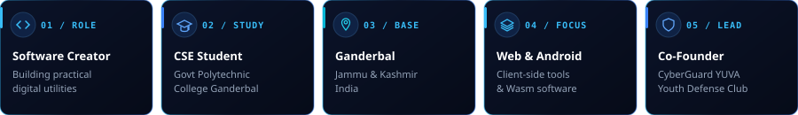
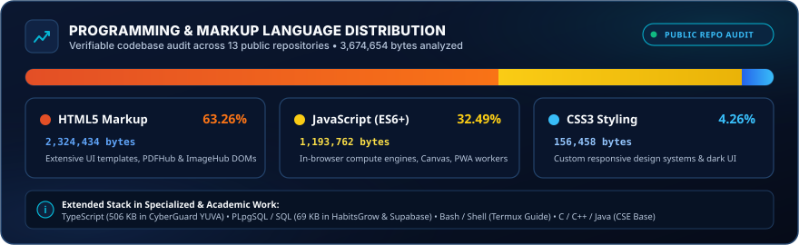

  

   

  

   

  

   
   

  

    
    &nbsp;
    
    &nbsp;
    
    &nbsp;
    
  

 

 

 

| Metric | Profile Specification | Details |
| :--- | :--- | :--- |
| **Developer Brand** | `@officialhazim42` | Software Creator & Web/Android Engineer |
| **Academic Base** | CSE Student | Government Polytechnic College Ganderbal, J&amp;K |
| **Engineering Mission** | Useful &amp; Private Tools | Zero-upload client-side processing &amp; accessible utilities |
| **Community Leadership** | Co-Founder | CyberGuard YUVA Youth Cyber Defense Club |

 

 

 

* **In-Browser & Client-Side Utilities:** Developing high-performance web applications that execute entirely within the client runtime using Web APIs, HTML5 Canvas, and WebAssembly, guaranteeing zero server uploads for user files.
* **Document & PDF Engineering:** Building complete document processing pipelines with client-side OCR, page reorganization, compression, and format conversions using `pdf-lib`, `pdf.js`, and `Tesseract.js`.
* **Image Processing & Optimization:** Creating browser tools for modern formats (AVIF, WebP), real-time compression ratio previews, and canvas image manipulation.
* **Progressive Web Applications:** Architecting responsive, installable PWAs with offline resilience, Service Worker caching, and local storage state persistence.

 

 

 

 

 

 

 

<table width="100%">
<tr>
<td width="50%" valign="top">
  
</td>
<td width="50%" valign="top">
  
</td>
</tr>
<tr>
<td width="50%" valign="top">
  
</td>
<td width="50%" valign="top">
  
</td>
</tr>
</table>

 

| Domain Category | Core Technologies | Project Evidence &amp; Ecosystem Role |
| :--- | :--- | :--- |
| **Primary Languages** | JavaScript (ES6+), TypeScript, Python | Core web application logic, CyberGuard Next.js portal, utility scripts |
| **Academic Base (CSE)** | C, C++, Java, Data Structures &amp; Algorithms | Polytechnic coursework, memory management, algorithms &amp; OOP foundations |
| **Systems &amp; Exploring** | PHP, Go, Rust | Actively exploring modern concurrent systems, microservices &amp; tool safety |
| **Markup &amp; Styling** | HTML5, CSS3, Tailwind CSS | Semantic accessible markup, dark-mode glassmorphism, responsive UI |
| **Frontend Frameworks** | React 19, Next.js 16, Vite | Component architecture, SSR/Edge rendering, fast bundling workflows |
| **Specialized Compute** | WebAssembly, HTML5 Canvas, pdf-lib, Tesseract.js | In-browser PDF processing, AVIF compression, client-side OCR |
| **Backend &amp; Cloud** | Supabase (PostgreSQL, Auth), Netlify Edge, Vercel | Relational schema design, RLS security, global edge hosting |
| **Tooling &amp; CLI** | Git, GitHub, VS Code, Termux Android Environment | Distributed version control, automation scripts &amp; on-device Linux CLI |

 

 

### 1. PDFHub — 33 Free Browser-Based PDF Tools
> **Zero Server Uploads • 100% In-Browser Privacy • Client-Side WebAssembly Suite**

<table width="100%">
<tr>
<td width="50%" valign="top">

A comprehensive, zero-budget PDF utility suite engineered to run entirely within the user's browser. Documents are processed locally on the client device using WebAssembly and client-side JavaScript engines, ensuring that confidential files never transmit across remote servers.

* **Capabilities:** Merge, split, organize, compress, extract text, client-side OCR, rotate, format conversion, and offline PWA capability.
* **Stack:** JavaScript (ES6+), WebAssembly, `pdf-lib`, `pdf.js`, `SheetJS`, `Tesseract.js`, HTML5 Canvas.
* **Architecture:** Netlify Edge (Canonical: `pdfshub.netlify.app` | Mirror: `pdfshub.smartstores.in`).

 

&nbsp;

</td>
<td width="50%" valign="middle" align="center">
  
</td>
</tr>
</table>

 

### 2. ImageHub — Professional In-Browser Image Utilities
> **Privacy-First Digital Image Manipulation Platform • 100% Local Execution**

<table width="100%">
<tr>
<td width="50%" valign="top">

A production-grade, client-side digital image manipulation platform. Enables users to compress, upscale, isolate subjects, crop, resize, edit, and convert photos without uploading a single byte to remote cloud servers.

* **Capabilities:** Client-side compression, subject isolation, smart cropping, dimensions resizing, format conversions (JPG, PNG, WebP, AVIF), and PWA installation.
* **Stack:** Pure JavaScript, HTML5 Canvas, Web APIs, CSS3, Service Workers.
* **Architecture:** Netlify Edge (Canonical: `imagehub.netlify.app` | Mirror: `imagehub.smartstores.in`).

 

&nbsp;

</td>
<td width="50%" valign="middle" align="center">
  
</td>
</tr>
</table>

 

### 3. Advanced Web Image Compressor
> **Client-Side Compression with AVIF Support &amp; Modern Glass UI**

<table width="100%">
<tr>
<td width="50%" valign="top">

A focused, responsive web tool engineered for fast image compression with real-time compression ratios and format detection.

* **Capabilities:** Support for JPG, JPEG, PNG, WEBP, and AVIF with fallback; GIF detection; smart batch naming; dark/light theme toggle; PDF export; zero backend dependencies.
* **Stack:** HTML5, CSS3, Vanilla JavaScript, Web APIs.
* **Architecture:** Netlify Deployment (`advance-images-compressor.netlify.app`).

 

&nbsp;

</td>
<td width="50%" valign="middle" align="center">
  
</td>
</tr>
</table>

 

### 4. The Ultimate Termux Command Guide
> **Comprehensive Handbook for Mastering Android CLI &amp; Termux API**

<table width="100%">
<tr>
<td width="50%" valign="top">

A structured, practical reference handbook and command guide for mastering native Linux command-line operations and device integration APIs within the Termux Android terminal environment.

* **Capabilities:** Categorized command indexes, Termux API integration recipes, package management workflows, troubleshooting tips, and setup instructions.
* **Stack:** Shell / Bash, Markdown, Android Termux Environment.
* **Status:** Open Reference Handbook on GitHub.

 

</td>
<td width="50%" valign="middle" align="center">
  
</td>
</tr>
</table>

 

### 5. Additional Work &amp; Capstone Projects

| Project | Focus Area | Technologies | Source Code |
| :--- | :--- | :--- | :--- |
| **Student Portfolio Showcase** | Final Capstone Project | HTML5, CSS3, JavaScript, Responsive DOM | [View Repository](https://github.com/officialhazim42/week-6-final-capstone-project) |
| **Production Deployment Dashboard** | Operations &amp; Monitoring Prototype | HTML5, CSS3, JavaScript, Metrics &amp; Logs | [View Repository](https://github.com/officialhazim42/week-5-deployment-production) |
| **Client-Side Form Validation &amp; QA** | Interactive Quality Assurance Suite | HTML5, CSS3, JavaScript, Edge-Case Testing | [View Repository](https://github.com/officialhazim42/week-4-testing-quality-assurance) |
| **Student Task Manager** | Offline-First Task Organization | HTML5, CSS3, JavaScript, LocalStorage PWA | [View Repository](https://github.com/officialhazim42/week-3-student-task-manager) |

 

 

<table width="100%">
<tr>
<td width="25%" align="center" valign="middle">
  
</td>
<td width="75%" valign="middle">

### CyberGuard YUVA — Youth Cyber Defense Club
**SECURE &nbsp;•&nbsp; EDUCATE &nbsp;•&nbsp; EMPOWER &nbsp;—&nbsp; Youth for a Safer Digital India**

I am the Co-Founder of **CyberGuard YUVA**, a youth-led cyber defense initiative established to foster cybersecurity literacy, defensive technical literacy, and safe digital practices among students.

* **Platform:** Engineered an interactive, responsive Progressive Web App to deliver accessible security guides.
* **Official Website:** [cyberguard-yuva.vercel.app](https://cyberguard-yuva.vercel.app/)

 

</td>
</tr>
</table>

 

 

 

 

 

 
 

  
  &nbsp;&nbsp;
  

 

 

 
 

  
  
  
  
  
  
  
  
  
  
  
  

 

  
<b>Accessible Contact Directory &amp; Copyable Handles</b>

   

| Channel / Platform | Verified Identity | Direct Connection Link |
| :--- | :--- | :--- |
| **GitHub** | `@officialhazim42` | [github.com/officialhazim42](https://github.com/officialhazim42) |
| **LinkedIn** | `hazim-bashir-faqeer` | [linkedin.com/in/hazim-bashir-faqeer](https://www.linkedin.com/in/hazim-bashir-faqeer) |
| **Email** | `hazimbashirfaqeer@gmail.com` | [hazimbashirfaqeer@gmail.com](mailto:hazimbashirfaqeer@gmail.com) |
| **Instagram** | `@officialhazim42` | [instagram.com/officialhazim42](https://www.instagram.com/officialhazim42/) |
| **YouTube** | `@officialhazim42` | [youtube.com/@officialhazim42](https://www.youtube.com/@officialhazim42) |
| **X (Twitter)** | `@officialhazim42` | [x.com/officialhazim42](https://x.com/officialhazim42) |
| **Threads** | `@officialhazim42` | [threads.net/@officialhazim42](https://www.threads.net/@officialhazim42) |
| **Telegram** | `@officialhazim42` | [t.me/officialhazim42](https://t.me/officialhazim42) |
| **Discord** | `officialhazim42` | [discord.com/users/officialhazim42](https://discord.com/users/officialhazim42) |
| **Reddit** | `u/officialhazim42` | [reddit.com/user/officialhazim42](https://www.reddit.com/user/officialhazim42) |
| **Base Location** | Ganderbal, Jammu &amp; Kashmir, India | [Open in Google Maps](https://www.google.com/maps/search/?api=1&query=Ganderbal%2C%20Jammu%20%26%20Kashmir%2C%20India) |

 

 
 

<!-- ================================================================= -->
<!-- 08.1 / DIRECT ACTION BUTTON BOARD                                 -->
<!-- ================================================================= -->

  

 

  
  &nbsp;
  
  &nbsp;
  
  &nbsp;
  
    
  
  &nbsp;
  
  &nbsp;
  
  &nbsp;
  
    
  
  &nbsp;
  
  &nbsp;
  

 
 

<!-- ================================================================= -->
<!-- PORTFOLIO FOOTER & VERIFIED DOMAIN ECOSYSTEM                      -->
<!-- ================================================================= -->

  

 

  
    <b>Verified Domains &amp; Live Platforms:</b>&nbsp;
    <a href="https://officialhazim42.github.io"><code>officialhazim42.github.io</code></a>
    &nbsp;•&nbsp;
    <a href="https://cyberguard-yuva.vercel.app/"><code>cyberguard-yuva.vercel.app</code></a>
    &nbsp;•&nbsp;
    <a href="https://imagehub.netlify.app/"><code>imagehub.netlify.app</code></a>
    &nbsp;•&nbsp;
    <a href="https://pdfshub.netlify.app/"><code>pdfshub.netlify.app</code></a>
    &nbsp;•&nbsp;
    <a href="https://advance-images-compressor.netlify.app/"><code>advance-images-compressor.netlify.app</code></a>
  
   
  
    <b>Direct Identity:</b>&nbsp;
    <a href="https://github.com/officialhazim42"><code>github.com/officialhazim42</code></a>
    &nbsp;•&nbsp;
    <a href="mailto:hazimbashirfaqeer@gmail.com"><code>hazimbashirfaqeer@gmail.com</code></a>
    &nbsp;•&nbsp;
    Ganderbal, Jammu &amp; Kashmir, India
  

