

  

   

  

   

  

   
   

  

    
    &nbsp;
    
    &nbsp;
    
    &nbsp;
    
  

 


  
  &nbsp;
  
  &nbsp;
  
  &nbsp;
  
  &nbsp;
  

| Metric | Profile Specification | Details |
| :--- | :--- | :--- |
| **Developer Brand** | `@officialhazim42` | Software Creator & Web/Android Engineer |
| **Academic Base** | CSE Student | Government Polytechnic College Ganderbal, J&amp;K |
| **Engineering Mission** | Useful &amp; Private Tools | Zero-upload client-side processing &amp; accessible utilities |
| **Community Leadership** | Co-Founder | CyberGuard YUVA Youth Cyber Defense Club |

 

 

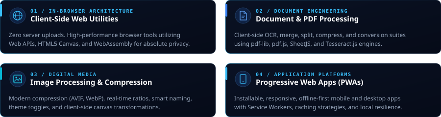

 

* **In-Browser & Client-Side Utilities:** Developing high-performance web applications that execute entirely within the client runtime using Web APIs, HTML5 Canvas, and WebAssembly, guaranteeing zero server uploads for user files.
* **Document & PDF Engineering:** Building complete document processing pipelines with client-side OCR, page reorganization, compression, and format conversions using `pdf-lib`, `pdf.js`, and `Tesseract.js`.
* **Image Processing & Optimization:** Creating browser tools for modern formats (AVIF, WebP), real-time compression ratio previews, and canvas image manipulation.
* **Progressive Web Applications:** Architecting responsive, installable PWAs with offline resilience, Service Worker caching, and local storage state persistence.

 

 

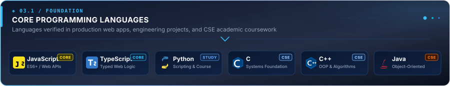

 

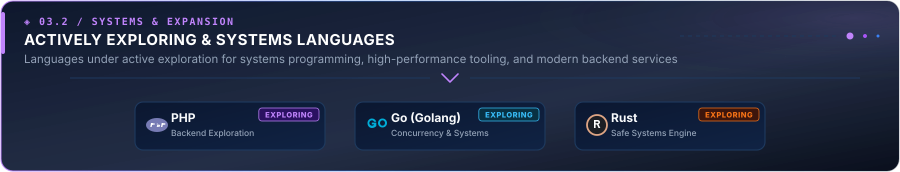

 

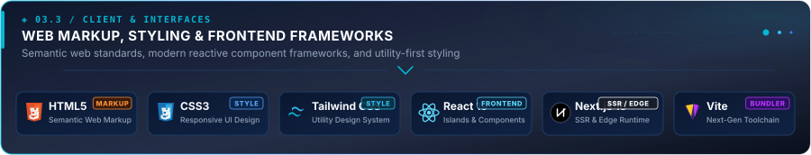

 

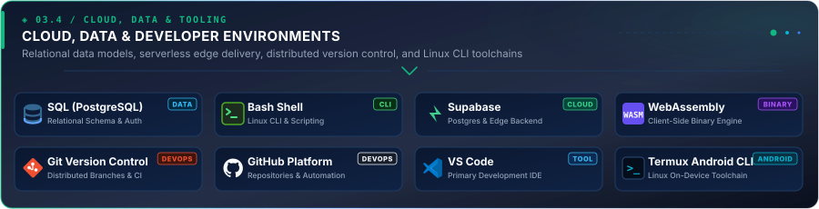

 

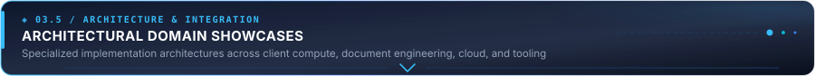

 

<table width="100%">
<tr>
<td width="50%" valign="top">
  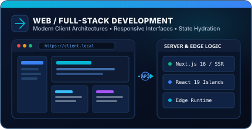
</td>
<td width="50%" valign="top">
  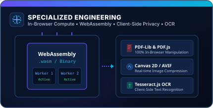
</td>
</tr>
<tr>
<td width="50%" valign="top">
  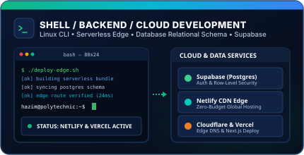
</td>
<td width="50%" valign="top">
  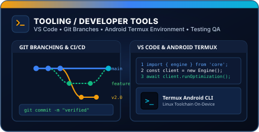
</td>
</tr>
</table>

 

| Domain Category | Core Technologies | Project Evidence &amp; Ecosystem Role |
| :--- | :--- | :--- |
| **Primary Languages** | JavaScript (ES6+), TypeScript, Python | Core web application logic, CyberGuard Next.js portal, utility scripts |
| **Academic Base (CSE)** | C, C++, Java, Data Structures &amp; Algorithms | Polytechnic coursework, memory management, algorithms &amp; OOP foundations |
| **Systems &amp; Exploring** | PHP, Go, Rust | Actively exploring modern concurrent systems, microservices &amp; tool safety |
| **Markup &amp; Styling** | HTML5, CSS3, Tailwind CSS | Semantic accessible markup, dark-mode glassmorphism, responsive UI |
| **Frontend Frameworks** | React 19, Next.js 16, Vite | Component architecture, SSR/Edge rendering, fast bundling workflows |
| **Specialized Compute** | WebAssembly, HTML5 Canvas, pdf-lib, Tesseract.js | In-browser PDF processing, AVIF compression, client-side OCR |
| **Backend &amp; Cloud** | Supabase (PostgreSQL, Auth), Netlify Edge, Vercel | Relational schema design, RLS security, global edge hosting |
| **Tooling &amp; CLI** | Git, GitHub, VS Code, Termux Android Environment | Distributed version control, automation scripts &amp; on-device Linux CLI |

 

 

  
  &nbsp;&nbsp;
  
  &nbsp;&nbsp;
  

  A curated portfolio of client-side web applications, in-browser graphics engines, privacy-focused utilities, and cybersecurity platforms engineered by <b>@officialhazim42</b>. Click any card or link to explore live deployments, source code, and architecture specifications.

<table width="100%">
<tr>
<td width="50%" valign="top">

### 01 &nbsp; 📄 PDFHub
`CLIENT-SIDE WEBASSEMBLY SUITE` &nbsp; 

<a href="https://pdfshub.netlify.app/">
  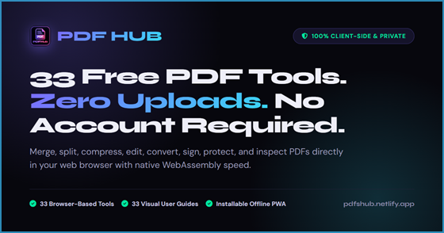
</a>

A comprehensive, privacy-first PDF utility suite engineered to execute 100% within the browser. Files are processed locally on the client device using WebAssembly and client-side JavaScript engines, guaranteeing that sensitive documents never touch external servers.

`JavaScript (ES6+)` `WebAssembly` `pdf-lib` `pdf.js`

 

[🌐 Live Demo](https://pdfshub.netlify.app/) &nbsp;•&nbsp; [💻 Repository](https://github.com/officialhazim42/pdfshub) &nbsp;•&nbsp; [🔍 Details →](PROJECTS.md#01-pdfhub)

</td>
<td width="50%" valign="top">

### 02 &nbsp; 🖼️ ImageHub
`IN-BROWSER GRAPHICS ENGINE` &nbsp; 

<a href="https://imagehub.netlify.app/">
  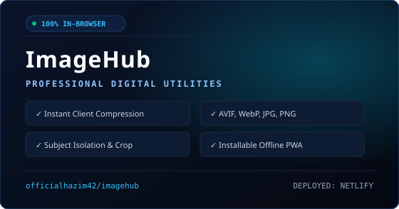
</a>

A production-grade, client-side digital image manipulation platform running locally in the web browser. Empowers users to compress, upscale, isolate subjects, crop, resize, and convert graphics without transmitting a single byte over the network.

`Pure JavaScript` `HTML5 Canvas` `Web APIs` `CSS3`

 

[🌐 Live Demo](https://imagehub.netlify.app/) &nbsp;•&nbsp; [💻 Repository](https://github.com/officialhazim42/imagehub) &nbsp;•&nbsp; [🔍 Details →](PROJECTS.md#02-imagehub)

</td>
</tr>
<tr>
<td width="50%" valign="top">

### 03 &nbsp; 🛡️ CyberGuard YUVA
`CYBER DEFENSE PORTAL & COMMUNITY` &nbsp; 

<a href="https://cyberguard-yuva.vercel.app/">
  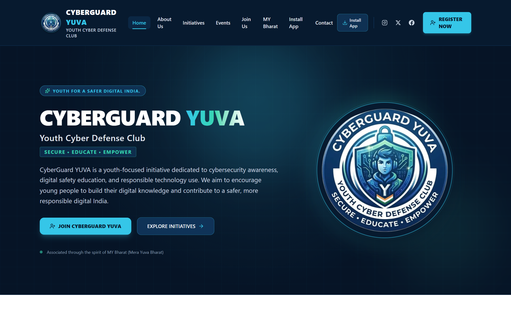
</a>

Official web portal and digital learning hub for CyberGuard YUVA, a youth-led cyber defense initiative dedicated to fostering defensive technical literacy, student privacy hygiene, and safe digital practices across schools and universities.

`Next.js 15+` `React 19` `TypeScript` `Tailwind CSS`

 

[🌐 Live Demo](https://cyberguard-yuva.vercel.app/) &nbsp;•&nbsp; 🔒 <i>Private Codebase</i> &nbsp;•&nbsp; [🔍 Details →](PROJECTS.md#03-cyberguard-yuva)

</td>
<td width="50%" valign="top">

### 04 &nbsp; 🌱 HabitsGrow (HabitFlow)
`PRODUCTIVITY & PERSONAL GROWTH PWA` &nbsp; 

A responsive, privacy-centric Progressive Web App designed to help individuals build positive routines, maintain completion consistency streaks, visualize progress analytics, and document mindfulness reflections.

`JavaScript (ES6+)` `PWA` `Service Workers` `HTML5/CSS3`

 

[🌐 Live Demo](https://habit-flow-ten-eta.vercel.app) &nbsp;•&nbsp; 🔒 <i>Private Codebase</i> &nbsp;•&nbsp; [🔍 Details →](PROJECTS.md#04-habitsgrow)

</td>
</tr>
<tr>
<td width="50%" valign="top">

### 05 &nbsp; ⚡ Advanced Image Compressor
`COMPRESSION UTILITY` &nbsp; 

<a href="https://advance-images-compressor.netlify.app/">
  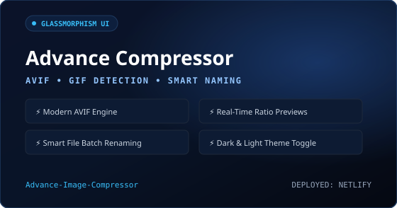
</a>

A focused, responsive web tool engineered for ultra-fast image compression with real-time compression ratios and format detection, packaged in a sleek dark glassmorphic UI.

`HTML5` `CSS3` `Vanilla JavaScript` `Web APIs`

 

[🌐 Live Demo](https://advance-images-compressor.netlify.app/) &nbsp;•&nbsp; [💻 Repository](https://github.com/officialhazim42/Advance-Image-Compressor) &nbsp;•&nbsp; [🔍 Details →](PROJECTS.md#05-advance-image-compressor)

</td>
<td width="50%" valign="top">

### 06 &nbsp; 💻 Termux Command Guide
`TECHNICAL DOCUMENTATION HANDBOOK` &nbsp; 

<a href="https://github.com/officialhazim42/Termux-Command-Listbook">
  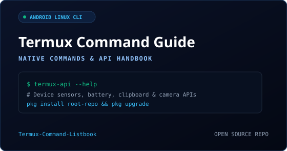
</a>

A structured, practical reference handbook and command guide for mastering native Linux command-line operations and device integration APIs within the Termux Android terminal environment.

`Shell / Bash` `Markdown` `Android Termux Environment` `Linux CLI`

 

[💻 Repository](https://github.com/officialhazim42/Termux-Command-Listbook) &nbsp;•&nbsp; [🔍 Details →](PROJECTS.md#06-termux-command-guide)

</td>
</tr>
<tr>
<td width="50%" valign="top">

### 07 &nbsp; 📸 Passport Photo Maker
`CLIENT-SIDE MEDIA TOOL` &nbsp; 

<a href="https://github.com/officialhazim42/Passportsize-photo-maker">
  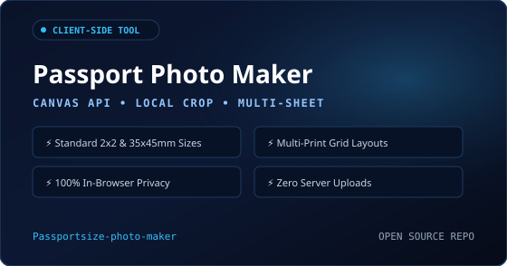
</a>

A client-side utility built with HTML5 Canvas that enables users to crop, scale, and format photographs to international passport standards and generate multi-photo sheets ready for printing.

`HTML5` `CSS3` `Vanilla JavaScript` `Canvas API`

 

[💻 Repository](https://github.com/officialhazim42/Passportsize-photo-maker) &nbsp;•&nbsp; [🔍 Details →](PROJECTS.md#07-passport-photo-maker)

</td>
<td width="50%" valign="top">

### 08 &nbsp; 🔊 Text to Audio Converter
`SPEECH SYNTHESIS TOOL` &nbsp; 

<a href="https://github.com/officialhazim42/Text-to-Audio-Converter">
  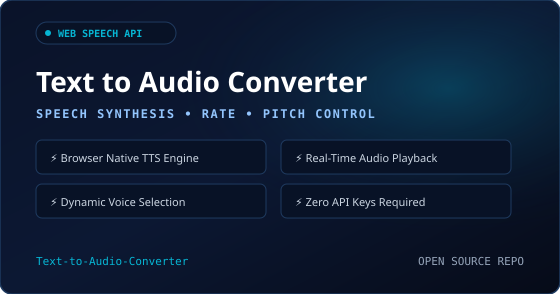
</a>

A lightweight web tool leveraging the browser-native Web Speech Synthesis API to convert written text into spoken audio with real-time controls for pitch, speech rate, and voice accents.

`HTML5` `CSS3` `JavaScript` `Web Speech API`

 

[💻 Repository](https://github.com/officialhazim42/Text-to-Audio-Converter) &nbsp;•&nbsp; [🔍 Details →](PROJECTS.md#08-text-to-audio)

</td>
</tr>
<tr>
<td width="50%" valign="top">

### 09 &nbsp; 📝 Student Task Manager
`ACADEMIC WORKFLOW WEB TOOL` &nbsp; 

<a href="https://github.com/officialhazim42/week-3-student-task-manager">
  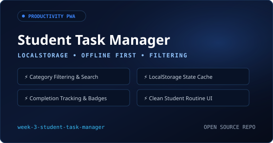
</a>

An interactive task organization web application engineered with HTML, CSS, and JavaScript, featuring task creation, completion tracking, filtering, deletion, and local storage state persistence.

`HTML5` `CSS3` `JavaScript` `LocalStorage API`

 

[💻 Repository](https://github.com/officialhazim42/week-3-student-task-manager) &nbsp;•&nbsp; [🔍 Details →](PROJECTS.md#09-student-task-manager)

</td>
<td width="50%" valign="top">

### 10 &nbsp; 📊 Deployment Dashboard
`DEVOPS & MONITORING PROTOTYPE` &nbsp; 

<a href="https://github.com/officialhazim42/week-5-deployment-production">
  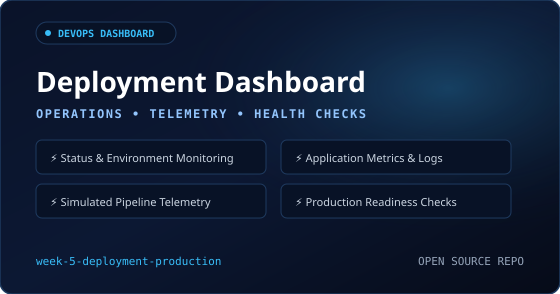
</a>

A production deployment dashboard prototype demonstrating environment status, application telemetry, performance metrics, simulated server logs, health checks, and production release concepts.

`HTML5` `CSS3` `JavaScript` `DOM Architecture`

 

[💻 Repository](https://github.com/officialhazim42/week-5-deployment-production) &nbsp;•&nbsp; [🔍 Details →](PROJECTS.md#10-deployment-dashboard)

</td>
</tr>
</table>

 

 

<table width="100%">
<tr>
<td width="30%" align="center" valign="middle">

  <a href="https://cyberguard-yuva.vercel.app/">
    
  </a>

</td>
<td width="70%" valign="top">

### 🛡️ CYBERGUARD YUVA
`DEFENSIVE CYBERSECURITY &amp; YOUTH DIGITAL SAFETY` &nbsp;  &nbsp; 

> **SECURE &nbsp;•&nbsp; EDUCATE &nbsp;•&nbsp; EMPOWER &nbsp;—&nbsp; Youth for a Safer Digital India**

Co-founded **CyberGuard YUVA**, a youth-led cyber defense initiative and community organization dedicated to cultivating defensive technical literacy, student privacy hygiene, threat resistance, and responsible online practices across schools and universities.

* **Flagship Platform:** Engineered an interactive, responsive Progressive Web App delivering structured cyber defense guides, threat advisory matrices, and student playbooks.
* **Community Leadership:** Leading student awareness programs, CTF preparation sessions, and collaborative digital safety campaigns.
* **Technology Stack:** Engineered with `Next.js 15+`, `React 19`, `TypeScript`, `Tailwind CSS`, `Lucide Icons`, and deployed on `Vercel Edge`.

 

&nbsp;&nbsp;

&nbsp;&nbsp;

</td>
</tr>
</table>

 


 

<b>🖥️ View CyberGuard YUVA Desktop Interface &amp; Live Platform Preview</b>

 

Official CyberGuard YUVA interactive web portal running in production at <a href="https://cyberguard-yuva.vercel.app/">cyberguard-yuva.vercel.app</a>

 

 

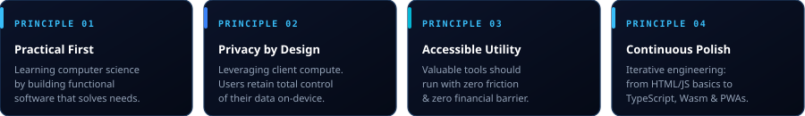

 

 

<!-- ================================================================= -->
<!-- ROW 1: TELEMETRY METRIC CARDS (TOTAL CONTRIBUTIONS, STREAKS)      -->
<!-- ================================================================= -->


 

<!-- ================================================================= -->
<!-- ROW 2: SIDE-BY-SIDE ANALYTICS (GITHUB STATS & LANGUAGE AUDIT)     -->
<!-- ================================================================= -->

<table width="100%">
<tr>
<td width="50%" valign="top">
  
</td>
<td width="50%" valign="top">
  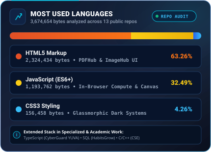
</td>
</tr>
</table>

 

<!-- ================================================================= -->
<!-- ROW 3: ANNUAL CONTRIBUTION ACTIVITY HEATMAP (365 DAYS)           -->
<!-- ================================================================= -->


 

<!-- ================================================================= -->
<!-- ROW 4: MONTHLY CONTRIBUTION VELOCITY & TREND TRAJECTORY          -->
<!-- ================================================================= -->


 

<!-- ================================================================= -->
<!-- VERIFIED TELEMETRY AUDIT MATRIX                                  -->
<!-- ================================================================= -->

| Telemetry Dimension | Verified Metric | Audit Scope &amp; Source Verification |
| :--- | :--- | :--- |
| **Total Contributions** | **229 Activity Units** | Verified across 365 calendar days (Oct 26, 2025 – Present) |
| **Current &amp; Longest Streak** | **9 Consecutive Days** | Active run: Oct 17 – Oct 25, 2026 (Verified streak record) |
| **Total Author Commits** | **107 Commits** | Direct author commits across 13 public repository trees |
| **Public Codebase Volume** | **3,674,654 Bytes (3.67 MB)** | HTML (63.26%), JavaScript ES6+ (32.49%), CSS3 (4.26%) |
| **Repository Footprint** | **13 Public Repositories** | Pure client-side engines, in-browser utilities &amp; PWA apps |

 

<!-- ================================================================= -->
<!-- DYNAMIC THIRD-PARTY TELEMETRY WIDGETS (FALLBACK ACCORDION)        -->
<!-- ================================================================= -->

<b>🔄 View Live Dynamic API Telemetry Badges (Third-Party Providers)</b>

 

  These dynamic widgets query third-party Vercel and Demolab endpoints in real time. If external services experience rate-limits or cold-starts, refer to the high-reliability verified telemetry dashboard above.

  
  &nbsp;&nbsp;
  

   
   

  

 

 

 

 
 

  
  
  
  
  
  
  
  
  
  
  

 
 

<!-- ================================================================= -->
<!-- DEVELOPER IDENTITY & FOOTER BRANDING                              -->
<!-- ================================================================= -->

  

